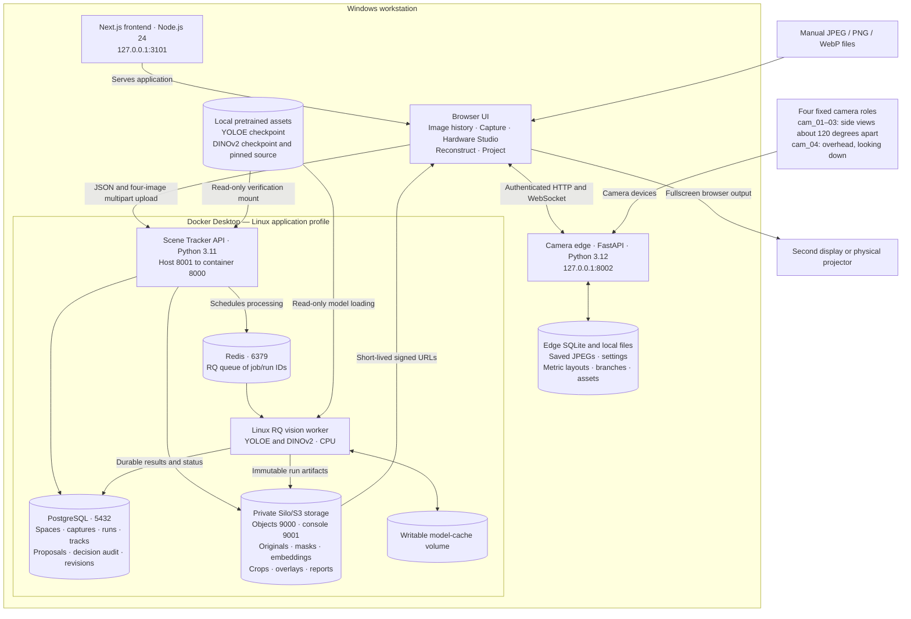
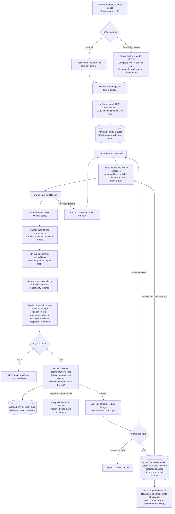
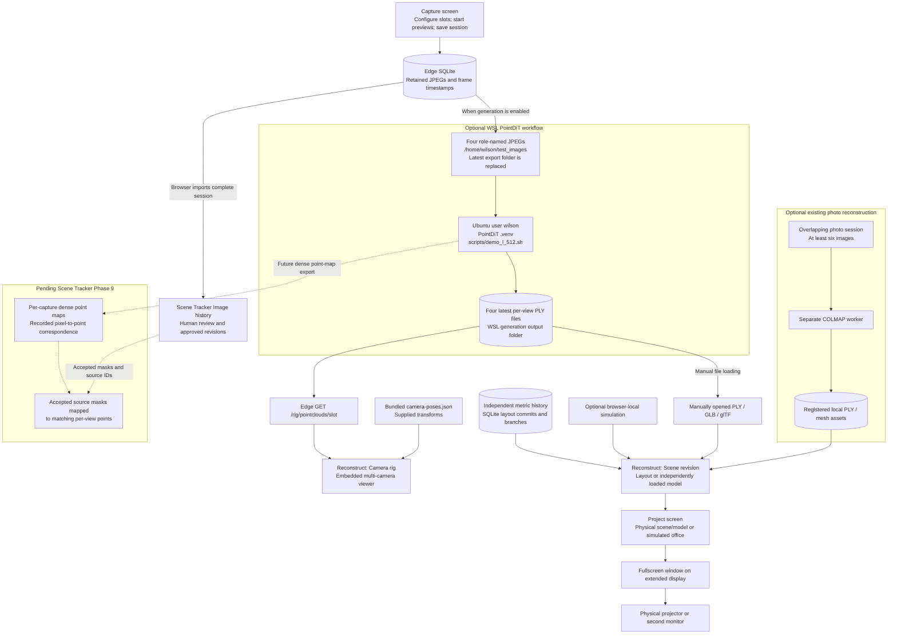

# SpaceGit workflow and system diagrams

These diagrams describe the merged implementation as of 15 November 2026.
Solid arrows describe implemented interfaces. Dashed arrows mark future Scene
Tracker Phase 9 work. The WSL PointDiT integration is a separate frontend/edge
workflow; its availability depends on that workstation's WSL installation.

## System layout and settings

| Setting | Local configuration |
| --- | --- |
| Frontend | `http://127.0.0.1:3101` |
| Scene Tracker API | `NEXT_PUBLIC_SCENE_TRACKER_URL=http://127.0.0.1:8001` |
| Camera edge | `NEXT_PUBLIC_SPACEGIT_EDGE_URL=http://127.0.0.1:8002` |
| Inference | `VISION_PROVIDER=real`, `YOLOE_DEVICE=cpu`, `VISION_DEVICE=cpu` |
| Models | Host `models/real-inference` mounted read-only at `/models` |
| Storage URLs | API uses `silo:9000`; browser uses signed `localhost:9000` URLs |
| Persistence | Separate PostgreSQL, Redis, Silo and model-cache volumes; edge SQLite/local files |
| Access | Loopback workstation; exact CORS origins; edge operator/local-session authentication |

Scene Tracker authentication remains outside the local MVP. The public frontend
demo does not call workstation services. The older checkout on 3000/3100/8000
remains separate. Settings are documented here without credentials.

## Image history: capture to approved revision

Accept and commit are separate actions. Rejected/unselected observations can leave
approved evidence on an older capture. Tracks are scoped to a space and camera;
missing from view does not establish physical removal. There is no automatic
cross-camera identity merge or metric movement estimate.

## Capture, reconstruction and projection

The camera-rig view has no automatic transfer of its combined display into Project.
Scene revision/model loading supplies the Project screen. An unordered PLY alone
cannot supply source-pixel correspondence. Supplied viewer poses do not establish
backend calibration, registration or a verified fused scene.

See [startup and operation](frontend-integration.md) and the
[frontend README](../frontend/README.md) for the WSL path requirements.
