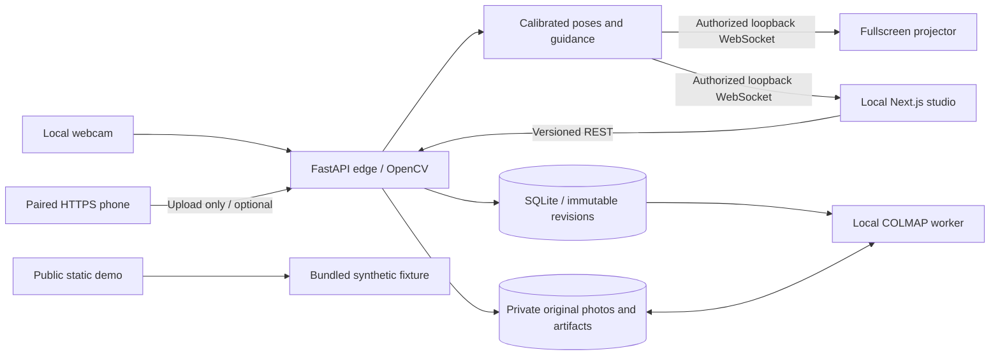

# SpaceGit architecture

The edge owns the camera, markerless object recognition, optional ArUco detection, calibration, guidance, and verification. Camera-only setup maps four selected corners to a planar frame. Projector calibration fits camera-to-projector correspondences from projected dots and checks an independent set before saving. A measured workspace composes the two mappings for metric guidance. The projector renders normalized geometry as a fullscreen SVG. The local browser and edge can operate offline once dependencies are installed.

The revision graph stores complete scene snapshots. Branch tips use optimistic concurrency, and merge checks the two tips again on approval. Historical rows cannot be updated or deleted through SQLite writes. Physical verification is a separate record with a sequence, timestamp, calibration ID, dwell and error. Edits and merges never move objects or mark them verified. Plan progress is in memory; recorded verification survives a restart. Restart interrupted plans from History.

This build supports one planar wall per local database and one operator key per running edge. The merge solver checks rotated object footprints, wall bounds, user-set clearance, and rectangular keep-out areas. It makes deterministic local adjustments and never assumes a safe path between target placements. The review binds the selected choices and candidate to the two unchanged branch tips.

The COLMAP process reads queued jobs and retained photos locally. Original uploads and generated artifacts are never bundled with the public site. Sparse and dense clouds, surfaces, and textures are visual evidence with arbitrary scale. Visual placement lives separately from the semantic scene revision, camera/projector fit, and physical deployment records.

Markerless tracking stores an immutable reference descriptor set in memory per selected object. Each observation needs distinct feature matches, a consistent homography, sufficient inlier coverage, and a plausible outline. Lost or stale poses cannot verify a restore. Restarting the edge requires reselection; use an existing revision identity to link the new reference to its history. The [acceptance matrix](verification.md) lists software and physical coverage.
